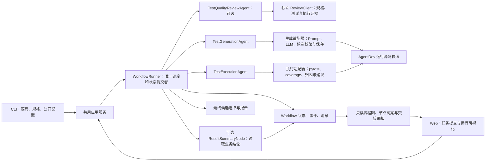
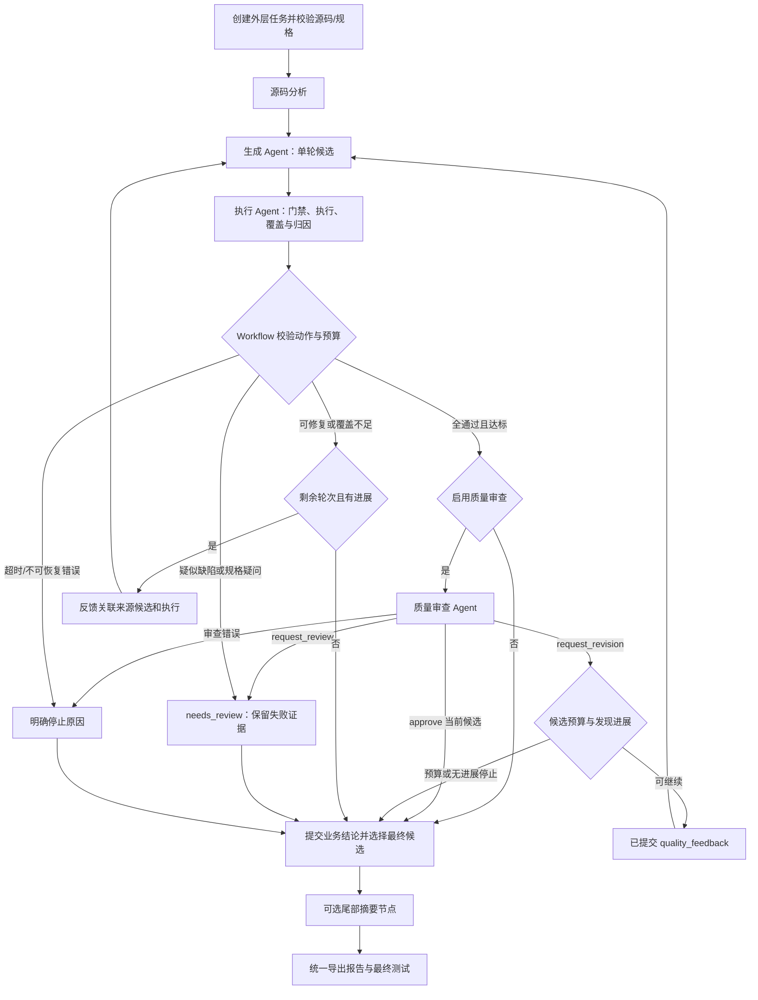
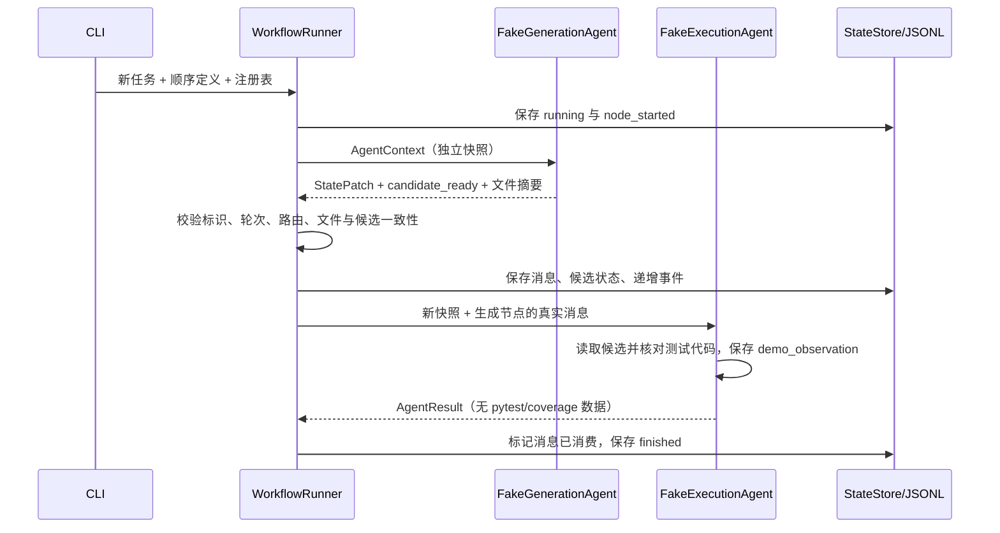

# 多 Agent 测试 Workflow 工程设计

> 2026-10-19 目录更新：三个 Agent 已并列整合到同一个包，当前结构与安装方式见 [Agent 目录说明](docs/agent-layout.md)。本文中的旧 vendor/包路径保留为历史实现说明，当前运行命令以 README 为准。

版本：质量审查 S9 准备 / 2026-10-18。已实现生成、执行与可选质量审查三个生产 Agent，默认关闭审查；共享服务、CLI/Web、三轮预算、质量反馈生成、证据报告与运行图均已接入。S8 全量 Workflow/vendor 1029 项及前端 25 项通过。S9 文档、三个真实案例和 45 秒离线演示已准备，真实调用因外传自动审批拒绝而等待明确授权，未计为完成。

P0–P7 的真实案例、数字和日期保留为历史证据，见 evaluation/review_20261013.md 等记录；质量增量见 [详细计划](docs/quality-review-agent-plan.md)、[S8](docs/quality-review-s8.md)、[S9](docs/quality-review-s9.md)。课程演示视频、最终提交版本和备用压缩包仍按原清单实际交付。

## 架构与职责



生成 Agent 接收源码事实、规格、历史和反馈，完成一次生成动作，不启动 pytest 或循环。执行 Agent 判断候选是否可执行、获取实测数据、保守归因并建议动作，不生成测试或调用生成节点。质量审查 Agent 根据原规格和当前测试/真实执行记录提出 approve、request_revision 或 request_review，不执行测试或修改共享状态。编排器读取流程定义与注册表，校验节点输出、提交状态、检查预算、决定后续节点；它不计作 Agent。

执行 Agent 采用规则策略和真实工具观察。规则选择修复/补充/复核动作，保留可解释依据；每个 Agent 是否都调用 LLM 不是当前课程约束。

## 流程与控制



门禁失败由执行节点返回修复建议且不启动 pytest。每个有效候选只执行一次带 coverage 的 pytest，从同次执行数据库导出目标 `subject.py` 数据。反馈的 `round` 是来源轮次，Workflow 指定下一次生成 `round + 1`。禁止将先前执行结果贴到新候选上。

动作沿用 `AgentAction`：`run_tests`、`repair_generated_test`、`add_missing_cases`、`request_review`、`finish`；初始化还有 `analyze_source`、`generate_tests`。主计划中的 `extend_tests` 消息示例仅表达补充语义，适配时统一为已有 `add_missing_cases` 或明确映射，避免混用枚举。

停止原因沿用 `StopReason`：coverage_target_met、round_limit_reached、no_progress、suspected_source_defect、ambiguous_specification、execution_timeout、unrecoverable_error。具体归因依据和边界见 [docs/reuse.md](docs/reuse.md)。

## 协议与状态所有权

P1 已建立 `AgentContext`、`AgentResult`、`Message`、`WorkflowState`。Context 保存状态的 JSON 快照，每次 `context.state` 返回独立解码对象，避免冻结的旧模型中嵌套字典被共享修改；Result 返回受限 `StatePatch`、消息和产物引用，不直接改共享对象。Message 使用版本、message_id、run_id、来源轮次、sender、receiver、type、payload。P3 增加 ExecutionAssessment/ExecutionFeedback；修复与补充消息带实测观察、问题、保护测试及缺口提示，并引用同轮 assessment。

WorkflowState 包含编排状态、业务结论、当前节点/轮次、公开配置、既有 AgentState、选中轮次、停止原因、最后事件序号和时间。只有 WorkflowRunner 提交状态；AgentDev 模型保持冻结、严格 Schema，通过 `updated()` 验证更新，序列化使用 `canonical_json()` 或 `model_dump(round_trip=True)`，避免把 computed_field 作为输入。

消息消费前检查任务、轮次、候选、接收节点及文件归属。同一进程内记录已消费消息标识；禁止越界路径与其他任务文件。文本、源码、模型响应和规格全部按数据处理，宿主命令固定，由工具调用 `shell=False` 执行。

## 工作区和产物

```text
outputs/<run_id>/
  run.json, state.json                 Workflow 任务元数据与状态
  events.jsonl, messages.jsonl         Workflow 事件、消息
  report.md, summary.json              汇总结果
  node_results/NN/<node>/              每次节点 Context/Result
  handoffs/NN/candidate.json           外层候选交接
  evaluations/NN/assessment.json       当前轮执行评估
  quality_reviews/NN/assessment.json    宿主审查记录与输入证据
  quality_reviews/NN/response.json      审查响应与独立用量
  final/test_subject.py, subject.py    可用时导出所选测试及源码副本
  agent_workspace/                    由生成适配器创建
    subject.py
    rounds/01/plan.json, candidate.json, llm_result.json, test_subject.py
    rounds/01/executions/run-*/         pytest、JUnit、coverage 证据
    rounds/02/...
```

首轮前只创建外层目录，内层尚不存在。若使用旧 `prepared_run_id`，内层只能有 run.json 与 trace.jsonl，且标识必须匹配；P1 优先选不预建内层的简单方案。如需要统一旧工具轨迹，适配器使用同一 Workflow run_id 创建旧 TraceWriter，再将其标识传给首轮保存函数；不要为凑一致性调用旧完整循环。

Workflow 轨迹和 AgentDev 工具轨迹分开写入，各自唯一写入者。旧报告只反映旧业务结果；新汇总报告还需包含两 Agent 调用、消息、路由、选中轮次和对应证据。

## 核心决策与实现顺序

| 决策 | 理由 | 验证阶段 |
|---|---|---|
| 三个 Agent 并列归入同一包，生成 Agent 内保留复用 core | 子进程显式加载集成后的 `_pytest_results` 插件；只安装当前项目 | 2026-10-19 目录整合 |
| 新 Workflow 不调用 run_agent/run_initial_step | 两者都含执行；完整闭环会掩盖节点协作 | P2/P4 |
| 复用 CandidateRound/ExecutionResult/CoverageResult | 避免重复定义不同含义的测试数据 | P1/P3 |
| 单进程同步，最多三轮 | 适合工时预算，现有路径与模型轮次也硬限制 3 | P4/P5 |
| 保留历史通过测试的 AST/场景/映射 | 补充覆盖不能删除或弱化已经通过的用例 | P2/P5 |
| 不增加覆盖率阈值参数 | 原模型固定 90%/80%，统一门禁和报告 | P3/P5 |
| 无模型 ResultSummaryNode 作为扩展示例 | 证明注册/流程定义扩展，不虚报第三个 Agent | P6 |

P1–P6 的实现和验证分别保留阶段记录；P7 做干净安装与提交。已实现契约见 [docs/protocol.md](docs/protocol.md)、[docs/generation.md](docs/generation.md)、[docs/execution.md](docs/execution.md) 和 [docs/workflow.md](docs/workflow.md)，阶段证据见 evaluation/p1.md 至 evaluation/p4.md、[P5 系统与真实验收](evaluation/acceptance.md) 和 [P6 验收](evaluation/p6.md)。报告格式与扩展接入见 [docs/reporting.md](docs/reporting.md)、[docs/extensions.md](docs/extensions.md)。

## P6 轨迹、报告与扩展

节点返回的 Result 先落盘并记录 node_output_saved，再验证任务/轮次/消息/文件/候选一致性；验证通过才消费输入、提交状态和记录 node_finished。message_sent/message_consumed 分别记录来源/接收轮次，同一 message_id/candidate_id/artifact_path 将第 N 轮 assessment 与第 N+1 轮生成输入关联。workflow_stopped 表示业务停止结论已确定；workflow_finished 只在最终报告保存后记录。跨文件写入并非事务，突然退出可能留下日志领先的快照，基础版只读查看、不续跑。

报告与机器摘要从已提交 CandidateRound、assessment、Context/Result 和 Event 生成，展示每轮测试数、执行/覆盖、动作建议、问题及摘要证据。selected 和 latest 单独展示；coverage unavailable 保留原因和实际 pytest 结果。原工具报告/日志不重写，最终文件保留选中候选原字节。

ResultSummaryNode 用相同同步接口注册到 SUMMARY_WORKFLOW 尾部，通过共享快照观察已确定的 task_status/stop_reason/selected_round，返回 report ArtifactRef，不修改业务状态、不调用模型或执行工具。CLI --with-summary 仅选择注册和定义，Workflow 的尾部通用循环不增加业务特例。它是扩展节点，不增加 Agent 数量。真正参与决策的评审 Agent 仍需明确扩充契约、路由与预算。

inspect --summary 校验登记产物与最终副本摘要并读取当前事件/节点记录，不写文件、不调用生成或执行。summary.json 的契约版本 1.1 是导出格式，保留原摘要键；Event 新增可选字段与事件类型，旧记录仍可读取。导出前摘要不包含最后一个 workflow_finished，最终快照/日志与只读 inspect 提供最终序号。

## P2 生成边界与路径映射

`TestGenerationAgent.run()` 先检查输入事实、目标轮次、工作区与已保存历史，再调用注入客户端一次。首轮使用 `generate_initial_candidate()`；修订先核对来源消息和 `choose_action()`，再复用 `build_action_context()` 与 `stage_revision_candidate()`。客户端内部有有限 HTTP 重试/格式修复，外层没有重试循环；节点没有执行工具调用。

原 vendor `CandidateRound.test_path` 是内层相对路径，Workflow 候选使用绝对路径以保持 P1 约定。原候选 JSON 不修改；适配器在 `handoffs/<round>/candidate.json` 写入 Workflow 版本，再以任务相对 ArtifactRef 交接。计划、原候选、LLM 结果、源码副本和测试文件均有摘要。候选校验失败仍保存证据并返回 `status=ok`（单步处理完成），但不发 `candidate_ready`；传输、配置、预算和工作区错误返回 `status=error`。

`AgentResult.generation` 是独立遥测：client_mode、client_calls、request_attempts、有限请求上限、格式修复数、用量与安全错误分类。失败提供不了次数时使用 null；离线/mock 外部请求数为 0。StatePatch 的 api_calls_delta 在新 Workflow 中计真实外部尝试，token_usage 是累计可得用量；token_usage_reported 允许把不可得累计量明确置空。

P2 验收脚本手动在节点外取得执行证据并构建下一轮反馈，记录保留为历史证据。P3 验收使用真实执行节点返回的反馈，再由脚本手动调用下一轮生成与执行；产品自动调度属于 P4。Assessment 的 completed 等字段仅为建议，协调脚本保持 running 和空 task_status，避免把单节点验收当作最终任务报告。

## P1 的实际运行结构



P1 产物放在外层 `demo_artifacts/01/`，内层 `agent_workspace/` 不创建。`task_status=null` 表示尚无测试业务结论。日志与状态不是跨文件事务；突然进程终止时日志可能领先于最后状态快照，基础版本只支持重新读取，不承诺续跑。状态写入失败时保留上一个可读取快照并向调用者暴露失败。


## S1–S9 质量增量与验收边界

quality_review_enabled 为严格布尔值且默认 false。启用后仅在基础真实全通过、行覆盖 ≥90% 且有分支时分支覆盖 ≥80% 时送审。生成/执行/审查通过 candidate_ready、review_ready、quality_feedback 协作，Workflow 保持唯一状态提交者；审查与执行反馈共用最多三轮候选。

审查输出的规格引用、目标函数、测试引用、固定路径文件及候选/规格 SHA-256 由宿主验证。request_revision 仅为合法追加场景建立生成例外，原 FINISH 判断和已通过测试 AST/场景/映射/支持代码保护保留。approve 绑定当前候选及其真实执行，selected/latest/exported 批准分别展示。预算或发现无进展停止为 partial，具体规格问题转 needs_review，审查异常保持 error，不能默认批准。

生产 DeepSeek 生成默认每次客户端调用最多 5 次 HTTP 尝试，审查默认最多 3 次且只允许一次格式修复；外层不自动重试。节点调用、HTTP 请求、模型 token 与 pytest 启动分开计数，未知总量保留 null 和已知小计。导出 summary 1.2 的 external_requests/token_usage 包含生成加审查，AgentState 统计保持生成口径，旧状态默认禁用审查，inspect 只读。

S9 验收脚本另限制全局 18 次派发、每案例 6 次、生成/审查每次最多 2 次尝试，用于三个指定样例，不修改生产默认策略。离线门槛演示展示 100% 覆盖后补齐 100→90 的规格场景；真实模型是否提出同一发现尚未实测，不将固定响应当作真实反馈。

当前不支持多文件项目、属性/变异测试、自动源码修复、任意 DAG 或并行 Agent、断点续跑和服务重启后的 Web 历史列表恢复；pytest 工作目录隔离不是安全沙箱。真实外传范围、自动审批阻塞、离线演示和验收证据见 S9 记录。
