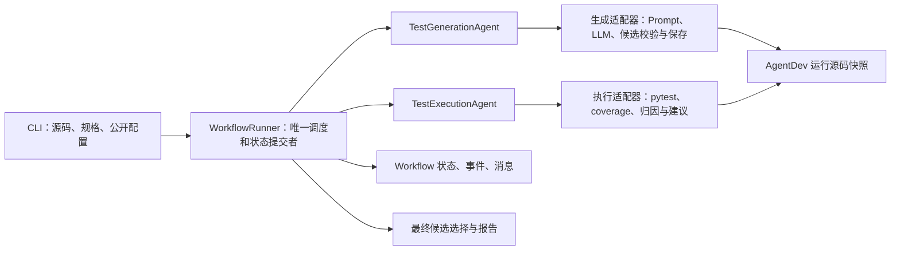
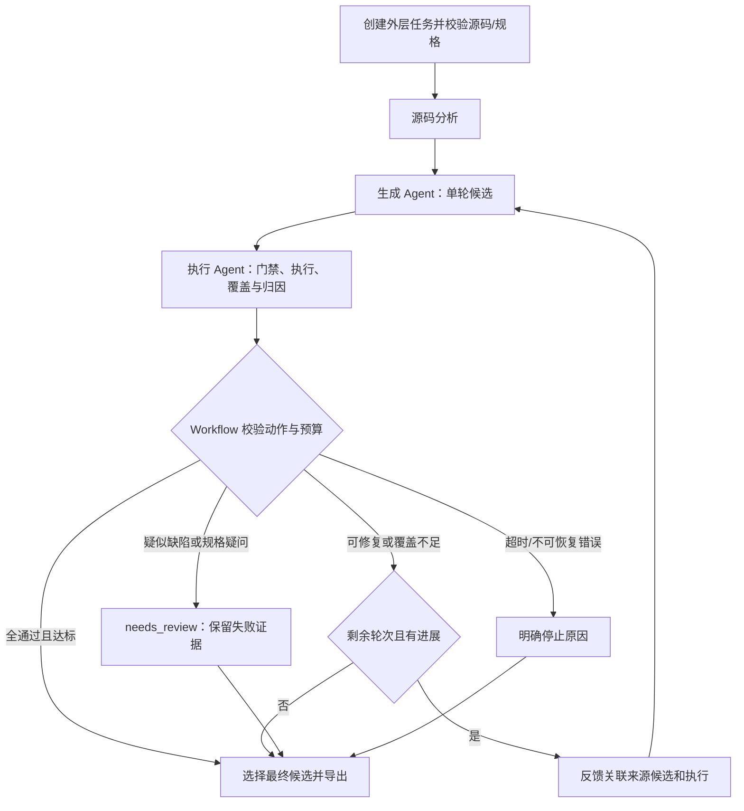
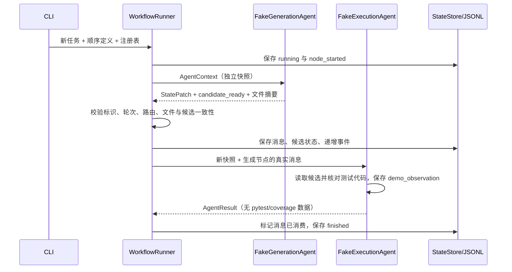

# 多 Agent 测试 Workflow 工程设计

版本：P2 / 2026-10-09。**已实现节点契约、注册表、顺序定义、状态与日志，以及单步首轮/修订生成节点；执行与评估 Agent、自动反馈路由和最终报告仍为 P3–P6 的实现约定。** 测试生成与执行能力来自 AgentDev，本项目新增节点边界、结构化交接、状态所有权和统一路由。

## 架构与职责



生成 Agent 接收源码事实、规格、历史和反馈，完成一次生成动作，不启动 pytest 或循环。执行 Agent 判断候选是否可执行、获取实测数据、保守归因并建议动作，不生成测试或调用生成节点。编排器读取流程定义与注册表，校验节点输出、提交状态、检查预算、决定后续节点；它不计作第三个 Agent。

执行 Agent 采用规则策略和真实工具观察。规则选择修复/补充/复核动作，保留可解释依据；每个 Agent 是否都调用 LLM 不是当前课程约束。

## 流程与控制



门禁失败由执行节点返回修复建议且不启动 pytest。每个有效候选只执行一次带 coverage 的 pytest，从同次执行数据库导出目标 `subject.py` 数据。反馈的 `round` 是来源轮次，Workflow 指定下一次生成 `round + 1`。禁止将先前执行结果贴到新候选上。

动作沿用 `AgentAction`：`run_tests`、`repair_generated_test`、`add_missing_cases`、`request_review`、`finish`；初始化还有 `analyze_source`、`generate_tests`。主计划中的 `extend_tests` 消息示例仅表达补充语义，适配时统一为已有 `add_missing_cases` 或明确映射，避免混用枚举。

停止原因沿用 `StopReason`：coverage_target_met、round_limit_reached、no_progress、suspected_source_defect、ambiguous_specification、execution_timeout、unrecoverable_error。具体归因依据和边界见 [docs/reuse.md](docs/reuse.md)。

## 协议与状态所有权

P1 已建立 `AgentContext`、`AgentResult`、`Message`、`WorkflowState`。Context 保存状态的 JSON 快照，每次 `context.state` 返回独立解码对象，避免冻结的旧模型中嵌套字典被共享修改；Result 返回受限 `StatePatch`、消息和产物引用，不直接改共享对象。Message 使用版本、message_id、run_id、来源轮次、sender、receiver、type、payload。P1 的 payload 包含 candidate_id、带 SHA-256 的任务相对文件引用、原因与可选建议动作；P3/P4 接入实测反馈时再扩充负载。

WorkflowState 包含编排状态、业务结论、当前节点/轮次、公开配置、既有 AgentState、选中轮次、停止原因、最后事件序号和时间。只有 WorkflowRunner 提交状态；AgentDev 模型保持冻结、严格 Schema，通过 `updated()` 验证更新，序列化使用 `canonical_json()` 或 `model_dump(round_trip=True)`，避免把 computed_field 作为输入。

消息消费前检查任务、轮次、候选、接收节点及文件归属。同一进程内记录已消费消息标识；禁止越界路径与其他任务文件。文本、源码、模型响应和规格全部按数据处理，宿主命令固定，由工具调用 `shell=False` 执行。

## 工作区和产物

```text
outputs/<run_id>/
  run.json, state.json                 Workflow 任务元数据与状态
  events.jsonl, messages.jsonl         Workflow 事件、消息
  report.md, summary.json              汇总结果
  agent_workspace/                    由生成适配器创建
    subject.py
    rounds/01/plan.json, candidate.json, llm_result.json, test_subject.py
    rounds/01/executions/run-*/         pytest、JUnit、coverage 证据
    rounds/02/...
    test_subject.py                    选中的最终候选
```

首轮前只创建外层目录，内层尚不存在。若使用旧 `prepared_run_id`，内层只能有 run.json 与 trace.jsonl，且标识必须匹配；P1 优先选不预建内层的简单方案。如需要统一旧工具轨迹，适配器使用同一 Workflow run_id 创建旧 TraceWriter，再将其标识传给首轮保存函数；不要为凑一致性调用旧完整循环。

Workflow 轨迹和 AgentDev 工具轨迹分开写入，各自唯一写入者。旧报告只反映旧业务结果；新汇总报告还需包含两 Agent 调用、消息、路由、选中轮次和对应证据。

## 核心决策与实现顺序

| 决策 | 理由 | 验证阶段 |
|---|---|---|
| 保留包名 testgen_agent，使用 vendor 快照 | 子进程依赖 `_pytest_results` 插件可导入；移交不依赖原目录 | P0/P7 |
| 新 Workflow 不调用 run_agent/run_initial_step | 两者都含执行；完整闭环会掩盖节点协作 | P2/P4 |
| 复用 CandidateRound/ExecutionResult/CoverageResult | 避免重复定义不同含义的测试数据 | P1/P3 |
| 单进程同步，最多三轮 | 适合工时预算，现有路径与模型轮次也硬限制 3 | P4/P5 |
| 保留历史通过测试的 AST/场景/映射 | 补充覆盖不能删除或弱化已经通过的用例 | P2/P5 |
| 不增加覆盖率阈值参数 | 原模型固定 90%/80%，统一门禁和报告 | P3/P5 |
| 无模型 ResultSummaryNode 作为扩展示例 | 证明注册/流程定义扩展，不虚报第三个 Agent | P6 |

P1 已完成协议、状态、注册、固定顺序调度和假节点 CLI；P2 已接首轮/修订；P3 接执行/归因；P4 扩充路由/预算/正式 CLI；P5 验收；P6 完善报告与扩展证明；P7 干净安装与提交。已实现契约见 [docs/protocol.md](docs/protocol.md) 和 [docs/generation.md](docs/generation.md)，阶段证据见 evaluation/p1.md 与 evaluation/p2.md。

## P2 生成边界与路径映射

`TestGenerationAgent.run()` 先检查输入事实、目标轮次、工作区与已保存历史，再调用注入客户端一次。首轮使用 `generate_initial_candidate()`；修订先核对来源消息和 `choose_action()`，再复用 `build_action_context()` 与 `stage_revision_candidate()`。客户端内部有有限 HTTP 重试/格式修复，外层没有重试循环；节点没有执行工具调用。

原 vendor `CandidateRound.test_path` 是内层相对路径，Workflow 候选使用绝对路径以保持 P1 约定。原候选 JSON 不修改；适配器在 `handoffs/<round>/candidate.json` 写入 Workflow 版本，再以任务相对 ArtifactRef 交接。计划、原候选、LLM 结果、源码副本和测试文件均有摘要。候选校验失败仍保存证据并返回 `status=ok`（单步处理完成），但不发 `candidate_ready`；传输、配置、预算和工作区错误返回 `status=error`。

`AgentResult.generation` 是独立遥测：client_mode、client_calls、request_attempts、有限请求上限、格式修复数、用量与安全错误分类。失败提供不了次数时使用 null；离线/mock 外部请求数为 0。StatePatch 的 api_calls_delta 在新 Workflow 中计真实外部尝试，token_usage 是累计可得用量；token_usage_reported 允许把不可得累计量明确置空。

P2 验收脚本手动在节点外取得执行证据并构建下一轮反馈。该脚本不承担产品反馈调度；P4 再把这一交接接入主流程。执行节点当前仍是假实现，不声明 P3 已完成。

## P1 的实际运行结构



P1 产物放在外层 `demo_artifacts/01/`，内层 `agent_workspace/` 不创建。`task_status=null` 表示尚无测试业务结论。日志与状态不是跨文件事务；突然进程终止时日志可能领先于最后状态快照，基础版本只支持重新读取，不承诺续跑。状态写入失败时保留上一个可读取快照并向调用者暴露失败。
