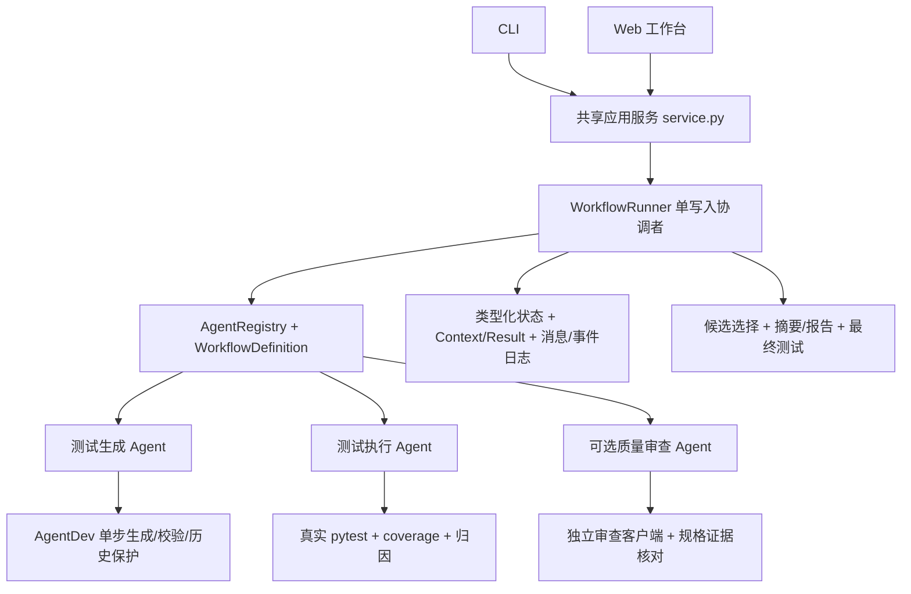
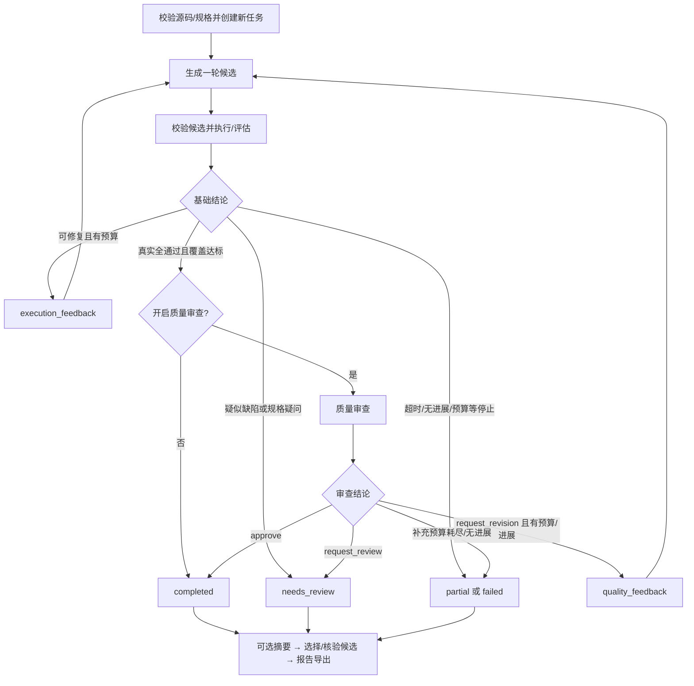

# 多 Agent 测试 Workflow 设计

本项目实现课程的测试方向：代码与行为规格 → 测试生成 → 真实执行 → 可选质量审查 → 反馈修订或导出。默认两个 Agent，开启审查后三个 Agent；所有入口使用同一服务和编排器。最终验收见 [逐项检查](evaluation/FINAL_CHECK.md)，使用方法见 [README](README.md)。

## 架构与职责

| 组件 | 职责与边界 |
|---|---|
| TestGenerationAgent | 规划并生成一轮测试，校验候选和历史通过测试保护；不启动 pytest |
| TestExecutionAgent | 核对交接文件，执行一次 pytest/coverage，分析失败并建议下一步；不直接改源码或测试 |
| TestQualityReviewAgent | 基础达标后检查规格场景和断言遗漏，核验发现引用，返回 approve/request_revision/request_review；不执行测试 |
| WorkflowRunner | 按定义调用节点，验证并提交结果、消费消息、限制轮次、路由、选择和导出 |
| ResultSummaryNode | 可注册的无模型尾部节点，观察已确定结论，展示扩展方式；不算 Agent |

三个 Agent 在 `agents/` 下并列，原 AgentDev 源码位于生成 Agent 的 `core/`。生成、执行与审查共享原数据模型和工具，避免复制出不一致的执行模型。详细迁移与导入见 [目录说明](docs/agent-layout.md)。

## 流程与分支

候选预算为 1–3 轮，执行修复和质量补充共享预算。无效候选只评估，不启动 pytest；失败节点阻止依赖节点。有效候选每轮仅执行一次，重复候选、无进展、超时、缺陷复核和预算耗尽均有明确停止原因。模型客户端的有限网络重试/格式修复另有请求预算，候选轮数不等于请求数。

审查仅针对基础测试全通过且覆盖达标的当前候选。阻塞发现必须带规格原文，引用的函数、测试名及代码片段须真实存在；这能验证引用来源，不能保证模型判断语义正确。人工问题不能自动转为批准。审查错误停止流程，不能以默认 approve 降级。

质量反馈送至下一轮生成时，保留已通过测试并新增场景；审查在同一候选上批准后才可完成。开启审查时，导出选择核对批准对象，避免以同分较早候选替代已批准的新候选。未开启审查时沿用历史候选选择策略；报告明确展示选中轮次与最新轮次。

## 通信与共享状态

节点统一实现 `run(context: AgentContext) -> AgentResult`，由 `AgentRegistry` 以稳定标识注册，`WorkflowDefinition` 声明顺序依赖和反馈边。节点读取独立状态快照，返回 StatePatch、消息及带 SHA-256 的相对产物引用；只有编排器提交共享状态。

交接包括 `candidate_ready`（生成→执行）、`execution_feedback`（执行→下轮生成）、`review_ready`（执行→审查）和 `quality_feedback`（审查→下轮生成）。协调者校验任务、候选、轮次、接收者、摘要、消息唯一性及消费状态。质量发现与批准绑定具体候选，不能套用到其他轮次。详见 [协议](docs/protocol.md)。

`workflow_status` 为 pending/running/finished/error，表示编排生命周期；`task_status` 为 completed/partial/needs_review/failed，表示测试业务结论。finished 不等于测试全部通过。全通过与覆盖达标、质量批准各自独立记录；无分支覆盖率为不适用，未知模型请求/token 保留 null 并提供已知小计。

## 持久化、报告与恢复边界

任务目录保存输入快照、`state.json`、`events.jsonl`、`messages.jsonl`、`node_contexts/`、`node_results/`、`handoffs/`、原 AgentDev 工作区、逐轮执行与审查证据，以及 `summary.json`、`report.md` 和可用的 `final/`。具体路径以实际产物索引为准。

文件用临时文件加原子替换保存，Windows 临时占用进行有限重试，不借此重复模型调用或执行。执行前后核对源文件与候选摘要；输出必须属于当前任务且不能覆盖已有任务。`inspect --summary` 只读核验已保存产物、反馈与批准归属，不能续跑。

单进程单写入者，JSONL 与状态不是跨文件事务，进程异常可能令日志领先于最后快照。当前恢复指受控重试、候选修复和保留证据，不承诺断点续跑、消息重放、分布式或 exactly-once。独立工作区不构成安全沙箱。

## CLI、Web 与扩展

CLI 的真实和离线模式使用同一生产流程；离线仅替换生成/审查客户端，仍真实执行 pytest/coverage。Web 使用真实 DeepSeek 客户端，后端以共享 service 创建任务，轮询投影状态和日志；本机监听、单任务执行，重启后历史任务可通过 CLI 检查。

运行图展示执行状态和证据，属于固定流程可视化，不提供拖拽编排。扩展节点可通过统一协议、注册表与顺序定义插入；已提供 ResultSummaryNode 示例。引入能改变业务结论的新 Agent 还须扩展契约、状态与受控路由，当前不是任意 DAG/并行调度引擎。详见 [扩展方法](docs/extensions.md)。

## 复用与验证策略

复用 AgentDev 的生成、校验、历史保护、真实执行、coverage、归因和业务模型，未把旧 `run_agent()` 整个闭环包装成单节点。生成与执行职责由新编排器分开调用单步能力；来源 57 文件、6 项先前补丁和目录迁移哈希分别有审计记录，见 [复用说明](docs/reuse.md)。

验证分为协议/门禁/状态/路由单元测试，CLI/HTTP 集成，固定响应加真实 pytest 的完整场景，前端投影测试，以及隔离目录 wheel 安装。固定响应验证可复现的协作机制；真实模型效果需要另行联网评估，不以固定响应替代。最终运行记录及课程要求映射见 [最终验收](evaluation/FINAL_CHECK.md)。
