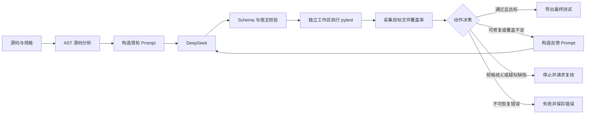

# TestGen Studio 设计说明

## 目标与边界

系统面向“一个 Python 源文件 + 一份明确行为规格”生成 pytest 测试。模型负责规划测试场景和产出代码；宿主程序负责读取源码、校验结构、执行测试、采集覆盖率、决定是否继续以及保存证据。

当前实现只处理单个不超过 128 KiB 的 Python 源文件中的 1–5 个顶层同步函数；不支持顶层类、异步语法、相对/通配符导入和第三方依赖。Web 和 CLI 都要求提供行为规格。它不承诺安全执行恶意代码，也不自动修改原始被测源码。覆盖率用于发现遗漏，不作为正确性的唯一依据。

## 运行数据流

`agent.run_agent()` 是 Web 和 CLI 共用的完整运行入口。Web 和 CLI 只负责收集输入、加载配置和展示结果，不复制控制策略。

## 核心模块

| 模块 | 职责 |
|---|---|
| `models.py` | 定义输入、源码事实、测试计划、候选轮次、执行结果和问题的不可变契约；另有 `FinalReport` 数据契约，当前导出使用 `summary.json` 与 `report.md` |
| `tools/code_analyzer.py` | 用 AST 提取函数、签名、分支、调用点、确认的同文件直接调用与未解析调用 |
| `prompts.py` | 构造首轮和反馈上下文，要求模型引用规格中的精确 oracle 证据 |
| `llm_client.py` | 发送 DeepSeek Chat Completions 请求，处理暂态重试、JSON 修复和用量统计 |
| `generation.py` | 交叉校验模型计划与源码事实，限制导入和绕过模式，保存候选 |
| `tools/test_runner.py` | 在任务目录中执行 pytest，解析 JUnit 和失败信息 |
| `tools/coverage_runner.py` | 独立导出 coverage JSON，只统计 `subject.py` |
| `failure_analysis.py` | 区分测试缺陷、覆盖缺口、环境错误、规格歧义和疑似源码缺陷 |
| `tracing.py` | 为模型生成步骤和宿主工具追加起止/失败事件，汇总适配器重试信息，并保存公开配置 |
| `reporting.py` | 基于选中轮次生成 `summary.json` 和人类可读的 `report.md` |
| `web.py` / `cli.py` | 用户入口 |

## 函数关联与测试集

AST 工具先记录同文件直接调用、无法静态确认的调用点、调用图入口候选和有限的数据流线索。模型再结合行为规格提出关联类型、涉及函数、证据、置信度以及测试策略。宿主程序交叉核验计划中的函数、调用点引用和场景映射；动态调用或仅凭命名推测的关系不能冒充已确认的直接调用。

计划可同时包含独立函数的单元场景和多个函数的协作场景。协作场景需要关联 ID、涉及函数和明确预期；多步流程可以附加步骤，不能只因为函数位于同一文件就自动合并。最终报告会显示 Agent 选择了哪些关联、依据是什么、哪些调用仍未确认，以及对应的测试策略。

## 候选与反馈循环

每次运行最多三轮。首轮根据源码事实和规格生成完整计划；后续轮次只能修复不可执行测试或补充缺失行为。历史中已经通过的测试必须保留，模型不能用删除断言的方式换取通过。

宿主在每轮后按固定顺序判断：

1. 候选是否通过语法、导入和计划一致性校验。
2. pytest 是否真实收集并执行了测试。
3. 失败能否由明确规格 oracle 解释为源码缺陷。
4. 目标行覆盖率是否至少 90%，存在分支时分支覆盖率是否至少 80%。
5. 是否还有轮次预算，或连续两轮没有进展。

当前自动标记 `suspected_source_defect` 的条件较窄：单函数、直接字面值相等断言、输入与规格表格或原文 oracle 能明确对应。多函数工作流、异常预期或复杂断言失败会保留证据并交由人工复核。规格没有给出预期值时，系统不会把实现行为猜成正确 oracle。

## 工作区与可追溯性

输出目录必须是新目录。原始源文件仅被读取，随后按原编码复制为任务内的 `subject.py`。模型只能返回结构化计划和测试代码，不能指定宿主路径或命令。

每轮模型生成步骤、工具开始/完成/失败、控制决策和最终结果会写入 `trace.jsonl`；实际 HTTP 尝试与格式修复次数由适配器汇总记录。`run.json`、`state.json`、`summary.json` 和 `report.md` 分别保存运行配置、状态与结论；轨迹按顺序追加，状态与报告在轮次或结束时直接写入。关键证据写入失败时不会宣称任务成功。Key、认证头和完整 Prompt 不写入产物。

## Web 与 CLI

Web 服务器使用标准库 `ThreadingHTTPServer`，默认绑定 `127.0.0.1:8765`。任务在后台线程运行，浏览器轮询进程内状态；服务重启后旧任务不再出现在页面列表，持久结果仍保存在文件中。报告弹窗展示 `report.md` 原文。

CLI 接受 `--source`、`--spec` 和可选 `--output`，使用同一 `run_agent()`。`--check-config` 只做本地配置验证，不发送请求。

## 验证结果

核心自动测试覆盖配置与密钥脱敏、模型契约、Prompt、源码/调用分析、候选保护、pytest/coverage 解析、失败归因、控制循环、轨迹和 Web API。

真实模型验收包括：

- 两个正确实现案例均在一轮内生成可运行测试并达到 100% 目标行覆盖。
- 八任务小型对照实验中，两种方案均有 5/8 任务完成；可评估缺陷的检出分别为 4/4 与 5/5。由于分母不同且未发生追加反馈请求，不能解释为反馈方案提升。
- 最新折扣边界案例生成 14 条测试，其中 13 条通过；输入 100 的规格断言暴露了源码边界缺陷，系统以 `needs_review` 停止，并保留 100% 行/分支覆盖证据。

结构化结果保存在 `evaluation/`。这些结论只适用于当前小样本和模型快照。

## 发布范围

安装包包含 `src/testgen_agent/` 下的运行模块和静态前端；仓库另保留示例、测试与 `evaluation/` 中的精简验收结果。当前仓库不存在 `archive/`，大体量原始运行目录未纳入提交。
