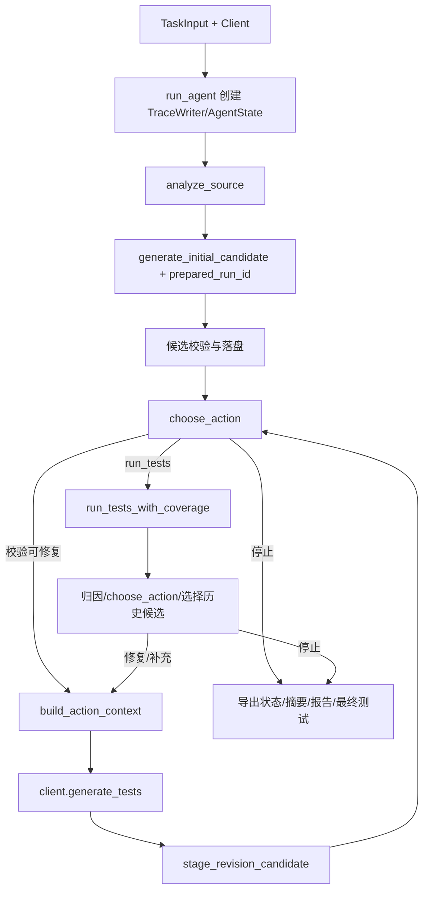

# AgentDev 复用审计与接入说明

版本：P0 / 2026-10-09。以下审计依据本次复制的实际源码，不仅依据旧文档。模块路径均相对 `vendor/agentdev/src/testgen_agent/`。

## 来源与快照

- 来源项目：AgentDev / TestGen Studio，原包名 `testgen_agent`，仓库地址 `https://github.com/ZHZ1111/AgentDev`（来自本地 Git 配置，未进行远端核验）。
- 本地 HEAD：`a347f85385547d90e9e2ff429665ae59a56ca298`。
- 复制 57 个文件，包括运行源码、前端静态文件、包元数据、锁定依赖、README/Design、占位配置、原测试和原样例。
- 不复制 `.env`、`.git`、虚拟环境、缓存、egg-info、build、历史输出或旧评估结果。
- 当前工作内容中 6 个文件与 HEAD blob 不一致：`.env.example`、`README.md`、`requirements.lock`、`examples/order_flow.md`、`src/testgen_agent/agent.py`、`tests/test_agent_loop.py`。快照保留这些实际内容；不能称为“纯 HEAD 导出”。
- 对每个文件保存 SHA-256、实际 Git blob、HEAD blob 和匹配标记，见 `evaluation/reuse_manifest.json`。复制文件全部在来源 HEAD 中有对应路径。
- 本次未修改旧 hw1 工程或快照业务源码。复制的新 `.env.example` 和依赖锁文件与快照一致。
- 来源目录未发现 LICENSE/COPYING/NOTICE 文件，未新增推断的许可证。作为用户既有课程项目复用保留来源说明；若以后对外发布，另行明确许可证。

## 旧 Agent 的完整闭环

P0 的 `scripts/p0_baseline.py` 允许调用完整 `run_agent()` 来验证旧系统。P2/P4 新生成节点和编排器不可调用这个完整闭环；`run_initial_step()` 同样包含可选 pytest 执行，不适合作为“只生成”的入口。

## 单步入口、返回类型与约束

| 入口/实际签名 | 返回 | 接入位置与注意事项 |
|---|---|---|
| `tools.analyze_source(source_path, *, max_bytes=131072)` | `SourceInfo` | 输入准备；源码分析不执行代码。1–5 顶层同步函数 |
| `generation.generate_initial_candidate(*, source, behavior_specification, oracle_mode, workspace, client, prepared_run_id=None)` | `InitialCandidateArtifacts` | 生成 Agent 首轮；调用一次 `client.generate_tests()` 后校验与保存，不执行 pytest |
| `generation.stage_initial_candidate(*, source, llm_result, workspace, expected_oracle_mode=None, prepared_run_id=None)` | `InitialCandidateArtifacts` | 若要分开生成/保存可直接使用；需保持相同 oracle_mode |
| `agent.build_action_context(state: AgentState)` | `GenerationContext` | 修订上下文，包含历史、缺口、调用链、保护测试及预算；会重新调用 `choose_action()`，只允许生成/修复/补充动作 |
| `GenerationClient.generate_tests(context: GenerationContext)` | `LLMGenerationResult` | 结构化客户端协议；真实实现 `DeepSeekClient(config, *, retry_policy=None, transport=None, sleep=..., max_tokens=None)`，离线客户端同接口 |
| `generation.stage_revision_candidate(*, source, llm_result, workspace, history, expected_oracle_mode=None)` | **`InitialCandidateArtifacts`** | 返回类型名虽含 Initial，实际也用于轮次 2/3；不是只返回 CandidateRound |
| `generation.validate_generated_tests(generated, source)` | `None`，不通过抛异常 | 要求计划 1.1、全部目标函数、真实关系证据、映射与有效断言、宿主可接受代码 |
| `tools.coverage_runner.run_tests_with_coverage(workspace, timeout=30, *, round_number=1)` | `CoverageRunResult` | 执行 Agent：execution、coverage、artifacts、source_hints；必须传本轮 round_number |
| `failure_analysis.classify_failures(state, candidate)` | `tuple[Issue, ...]` | 执行 Agent 保守归因；缺陷、歧义、生成错误、环境问题 |
| `agent.choose_action(state)` | `ActionDecision` | 执行 Agent 建议策略；含 action/reason/stop_reason/feedback/issues/status。它也检查旧轮次预算，Workflow 仍需验证预算 |
| `agent.apply_decision(state, decision)` | 新 `AgentState` | 可在编排提交处复用，不让 Agent 修改共享状态 |
| `agent.select_best_candidate(history)` | `int \| None` | 最终选择；全通过优先、达标优先、覆盖可用优先、分支/行覆盖、通过数，同分保留早轮 |
| `reporting.build_summary(state, decision, final_path, trace: TraceWriter)` | `dict` | 旧业务摘要可复用；新层另加入 Workflow 协作信息 |
| `reporting.render_markdown_report(state, decision, summary)` | `str` | 旧报告内容复用基础；新报告需要新增节点、消息与路由证据 |
| `tracing.TraceWriter(root, run_id, metadata)` | 写入器 | 创建新目录、run.json 和 trace.jsonl；可为适配器工具轨迹单独使用 |

`InitialCandidateArtifacts` 含 workspace、subject_path、plan_path、candidate_path、llm_result_path、candidate、llm_result，属性 `test_path` / `ready_for_execution`。生成候选校验失败通常保存 `candidate.validation_error` 并不给 test_path，仍返回 artifacts，不能假定失败一定抛异常。

## 模型与序列化

| 模型 | 核心作用 | 接入约束 |
|---|---|---|
| `TaskInput` | 源路径、规格路径、输出目录、轮数、超时、ModelInfo | 旧模型的 spec_path 可以为空；新 Workflow 必须主动强制非空规格 |
| `SourceInfo` | 源码、编码、函数、分支、调用事实 | 状态要求 source_path 与 TaskInput 一致，接入时统一绝对解析 |
| `GeneratedTests` / `TestPlan` | 计划、场景、关系、策略、代码、映射、questions | 使用 schema_version 1.1；questions 会导致复核 |
| `LLMGenerationResult` | 响应、次数、修复次数、调用记录、用量 | 一次生成动作可能包含多次 HTTP 请求；轮数不能等同请求数 |
| `CandidateRound` | 每轮候选、校验、执行、coverage | 有校验错误不能附执行；coverage 不能先于执行；available 不等于全通过 |
| `AgentState` | 连续历史、当前轮次、选中候选、问题、动作、停止原因 | current_round 等于 history 长度，轮次连续且不超预算；状态/计划版本一致 |
| `CoverageResult` | 目标文件计数、缺失行/分支 | unavailable 时指标为空且有原因；无分支 branch_percent 为 None |
| `ExecutionResult` | 真实 pytest 结果及失败观察 | skipped/xfailed/xpassed 不能视为全部通过；不能只看进程退出码 |

`ContractModel` 冻结、额外字段拒绝、更新需校验。使用 `updated()`；持久化使用 `canonical_json()`，恢复使用 `model_validate_json()`。把带 computed_field 的普通 `model_dump()` 输出原样送回校验会触发额外字段错误。

## 工作区与历史保护

1. 首轮 `stage_initial_candidate()` 默认 `mkdir(exist_ok=False)`，工作区已存在即拒绝覆盖。`generate_initial_candidate()` 在创建工作区之前调用客户端，因此 Workflow 应先检查路径，避免为已存在目录消耗模型请求。
2. 如传 prepared_run_id，工作区必须为普通目录、不能为符号链接或 junction，**恰好**含 run.json 和 trace.jsonl，run.json 标识一致。Workflow 的文件只写外层。
3. 修订需非空、从 1 连续编号的历史；目标轮次为 len(history)+1。`round_directory()`、`RoundNumber`、AgentState 均硬限制最多 3。
4. 修订前验证 `subject.py` 字节等于源码快照，禁止覆盖已有轮次，路径解析受任务目录归属检查。
5. `preserved_tests()` 只保护能够从完整执行观察确认通过的测试。任一参数化实例失败，会排除该测试函数；跳过/xfail/xpass 或不完整失败观察不能据此建立保护。
6. `validate_preserved_tests()` 要求保留通过测试的函数 AST（含装饰器）、导入/常量/辅助函数、场景映射、输入、预期和关系证据；新增支持绑定不能覆盖旧依赖。补充场景应新增命名函数，不能改写已通过断言。
7. 修订代码 AST 与历史有效代码相同，记 duplicate_candidate 并停止无进展；新候选覆盖不提高也可能停止。
8. pytest 子进程显式加载 `testgen_agent.tools._pytest_results`。必须在**当前解释器环境**安装 vendor 包，不能只向父进程临时插入 sys.path。

## 异常与降级

| 失败类型 | 现有表现 | 新层处理 |
|---|---|---|
| 文件/编码/语法/不支持输入 | SourceReadError/SourceAnalysisError/UnsupportedSourceError | 输入失败，不启动生成；保存错误事件 |
| 模型请求或结构化输出 | LLMError（含安全的 code/details） | 保存安全摘要，有限客户端重试后停止；不输出 Key/header |
| 候选语法、映射、oracle、保护失败 | CandidateValidationError 或 candidate.validation_error | 不执行，返回修复建议；按预算路由 |
| 工作区不存在/越界/副本变化 | FileExistsError/ExecutionWorkspaceError | 阻止依赖步骤，保留之前证据 |
| pytest 超时/启动/收集/执行失败 | ExecutionResult.kind 与真实观察 | 区分超时、环境、生成错误和复核 |
| coverage 导出/解析失败 | coverage.status=unavailable，保留 execution | partial/failed，不能声称覆盖达标 |
| 产物写入失败 | ExecutionArtifactError/TraceArtifactError/OSError | 明确编排 error；不能伪称保存成功 |

## 失败归因的实际能力边界

自动疑似缺陷判断目前主要支持**单目标函数、非参数化、单场景映射、单参数常量调用的等值 assert**，并以两列表格或准确规格原文支撑。异常预期、多参数/多函数协作和复杂断言失败通常输出 ambiguous_specification/needs_review，不能保证自动缺陷分类。

discount 样例用独立测试 `assert calculate_discount(100) == 90`，规格中有 `100 → 90` 两列表格，符合现有保守识别路径。不修改原实现的 `amount > 100`，不为了通过把预期改成 100。

## P2 适配已完成，后续边界

P2 已将首轮、修订上下文、一次客户端调用和保存封装到 `test_workflow.agents.test_generation.TestGenerationAgent`。`adapters/agentdev.py` 使用 `generate_initial_candidate()`、`build_action_context()`、`choose_action()` 与 `stage_revision_candidate()`；没有调用旧完整闭环或执行工具。choose_action 在修订前用于核对反馈动作是否仍被证据允许，不触发下一轮。

原候选文件不修改；相对 test_path 映射为 Workflow 绝对 test_path 后另存 `handoffs/<round>/candidate.json`。原始计划、候选、LLM 结果和测试文件继续保留，并注册相对文件引用及摘要。原工具结果直接放入原 CandidateRound 模型，不复制执行/coverage 模型。失败次数、用量保留旧客户端可提供的证据；未知字段为空，外层不重试。新代码和协议增加集中在 Workflow 包，vendor 和旧 hw1 工程未修改。

P2 相关生成、客户端、提示词回归共 74 项通过，证据见 `evaluation/p2_vendor_tests.xml` 和 `evaluation/p2_vendor_tests.txt`。P3 将 coverage 工具、失败分类和建议封装成执行节点；P4 负责完整历史提交、路由和导出。旧 `_export_results()` 是私有入口，P0 仅记录；后续优先使用公开 reporting/模型组合输出，必要快照修改必须在此补记差异与回归结果。
