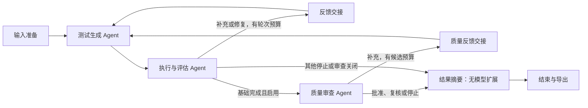

# 运行可视化

日期：2026-10-17（S7；保留 2026-10-13 运行投影机制）。Web 使用正式 Workflow 的同一任务快照，提供固定图、节点进度和 Agent 交接；页面负责展示，调度和业务结论仍由 WorkflowRunner 决定。

## 使用

按 README 启动 `python -m test_workflow web`，填写源码与非空行为规格后运行。表单初始为空，仅使用 DeepSeek，每轮 pytest 默认超时 60 秒。运行图位于输入表单下方：



- 节点显示等待、进行中、已完成、需要复核、失败或未启动；进行中的节点蓝色高亮，系统减少动态效果时关闭脉冲动画。
- 进入下一轮后重新显示该轮生成/执行状态，先前已经消费的反馈继续保留，不能把上一轮的执行完成当成下一轮完成。
- 点击节点显示本轮最近事件、耗时、节点结果相对路径、消息 ID 和候选归属；交接卡片分别显示候选消息及执行反馈的发送者、接收者、来源轮次和消费状态。
- 摘要完成后保存报告/最终文件仍属于进行中；`workflow_finished` 或 HTTP 终态到达后才显示结束。`needs_review` 和 `partial` 使用复核颜色，`failed` 或编排错误显示失败，不能用绿色冒充达标。
- 原有逐轮测试数、覆盖率、事件、原始消息、测试与报告下载保留；短暂节点可能因轮询间隔只展示完成证据，完整顺序以事件日志为准。

## 数据来源与边界

`/api/runs/<id>` 返回同一任务的 `state.json`、`events.jsonl`、`messages.jsonl` 和最终 `summary.json`。`web_static/workflow-view.js` 对这些数据做只读状态投影；事件用于确认节点实际启动/结束，消费证据来自状态中的 `consumed_message_ids` 或 `message_consumed` 事件。界面没有另设调度状态，不推算模型进度百分比。

源码、规格和消息内容通过文本节点呈现，不作为页面命令执行。固定图投影生成、执行、可选质量审查及 ResultSummaryNode，没有拖拽编辑、任意 DAG 或并行调度能力。

S6 增加默认关闭的“启用质量审查”复选框，严格布尔字段传给同一共享服务。S7 增加第三节点、执行→审查→摘要与独立质量反馈边；基础未完成使用执行→摘要路径。关闭显示 disabled，基础未满足送审条件显示 skipped 原因，等待/人工复核/错误分别呈现。审查只依据当前轮次事件/记录，新轮次不会继承旧批准，缺少当前批准不能显示绿色结束。

逐轮质量卡展示基础执行结论、审查决定、规格与测试引用、目标函数、补充建议、人工问题、证据路径和反馈消费位置。交接卡同时区分 execution_feedback 与 quality_feedback；待消费反馈不能画成已返回生成节点。顶部显示质量状态、未解决发现来源、选中/最新/实际导出候选批准，以及生成/审查/总请求与 token。未知量保留未知并展示已知小计；旧质量摘要没有分项总量时不把生成计数当成完整总量。

排队阶段 API 返回已接受的 quality_review_enabled，状态文件创建前仍显示正确开关及等待，不推断节点已调用。桌面保持横向六节点，窄屏转为纵向，反馈路径换行。入口见 [S6 记录](quality-review-s6.md)，新投影、DOM 文本安全测试、桌面/390 像素浏览器检查和截图见 [S7 记录](quality-review-s7.md)。

同一服务期间刷新页面，通过 sessionStorage 中的任务 ID 恢复任务并继续轮询；源码与规格输入框仍为空。服务重启后内存任务列表不会自动恢复，历史产物仍由 CLI `inspect` 读取。该限制没有因新增图而改变。

## 验证

```powershell
node --test tests/web/*.test.cjs
.\.venv\Scripts\python.exe -m pytest tests/test_workflow_web.py tests/test_cli.py -q
```

Node 仅用于开发测试，不是 Python 应用或浏览器运行依赖。GitHub Actions 同时运行前端状态测试和既有 Python 回归。实际结果、浏览器截图及新 wheel 静态资源检查见 [初始验收](../evaluation/run_visualization_20261013.md)；S7 新增质量视图后前端共 25 项通过，质量回归及安装结果见对应阶段记录。
