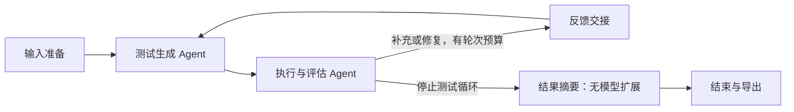

# 运行可视化

日期：2026-10-13。Web 使用正式 Workflow 的同一任务快照，提供固定图、节点进度和 Agent 交接；页面负责展示，调度和业务结论仍由 WorkflowRunner 决定。

## 使用

按 README 启动 `python -m test_workflow web`，填写源码与非空行为规格后运行。表单初始为空，仅使用 DeepSeek，每轮 pytest 默认超时 60 秒。运行图位于输入表单下方：



- 节点显示等待、进行中、已完成、需要复核、失败或未启动；进行中的节点蓝色高亮，系统减少动态效果时关闭脉冲动画。
- 进入下一轮后重新显示该轮生成/执行状态，先前已经消费的反馈继续保留，不能把上一轮的执行完成当成下一轮完成。
- 点击节点显示本轮最近事件、耗时、节点结果相对路径、消息 ID 和候选归属；交接卡片分别显示候选消息及执行反馈的发送者、接收者、来源轮次和消费状态。
- 摘要完成后保存报告/最终文件仍属于进行中；`workflow_finished` 或 HTTP 终态到达后才显示结束。`needs_review` 和 `partial` 使用复核颜色，`failed` 或编排错误显示失败，不能用绿色冒充达标。
- 原有逐轮测试数、覆盖率、事件、原始消息、测试与报告下载保留；短暂节点可能因轮询间隔只展示完成证据，完整顺序以事件日志为准。

## 数据来源与边界

`/api/runs/<id>` 返回同一任务的 `state.json`、`events.jsonl`、`messages.jsonl` 和最终 `summary.json`。`web_static/workflow-view.js` 对这些数据做只读状态投影；事件用于确认节点实际启动/结束，消费证据来自状态中的 `consumed_message_ids` 或 `message_consumed` 事件。界面没有另设调度状态，不推算模型进度百分比。

源码、规格和消息内容通过文本节点呈现，不作为页面命令执行。固定图目前投影默认的两个核心 Agent 与 ResultSummaryNode，没有拖拽编辑、任意 DAG 或并行调度能力。

2026-10-17 的 S6 已增加默认关闭的“启用质量审查”复选框，页面将严格布尔字段 quality_review_enabled 传给同一共享服务，实际运行第三个审查节点。审查事件、类型化送审/质量反馈消息和原始状态可读取；完整审查节点图、质量反馈边及请求/用量汇总仍待 S7，不将现有双 Agent 图视为完整质量流程。入口与验证见 [S6 记录](quality-review-s6.md)。

同一服务期间刷新页面，通过 sessionStorage 中的任务 ID 恢复任务并继续轮询；源码与规格输入框仍为空。服务重启后内存任务列表不会自动恢复，历史产物仍由 CLI `inspect` 读取。该限制没有因新增图而改变。

## 验证

```powershell
node --test tests/web/*.test.cjs
.\.venv\Scripts\python.exe -m pytest tests/test_workflow_web.py tests/test_cli.py -q
```

Node 仅用于开发测试，不是 Python 应用或浏览器运行依赖。GitHub Actions 同时运行前端状态测试和既有 Python 回归。实际结果、浏览器截图及新 wheel 静态资源检查见 [本次验收](../evaluation/run_visualization_20261013.md)。
