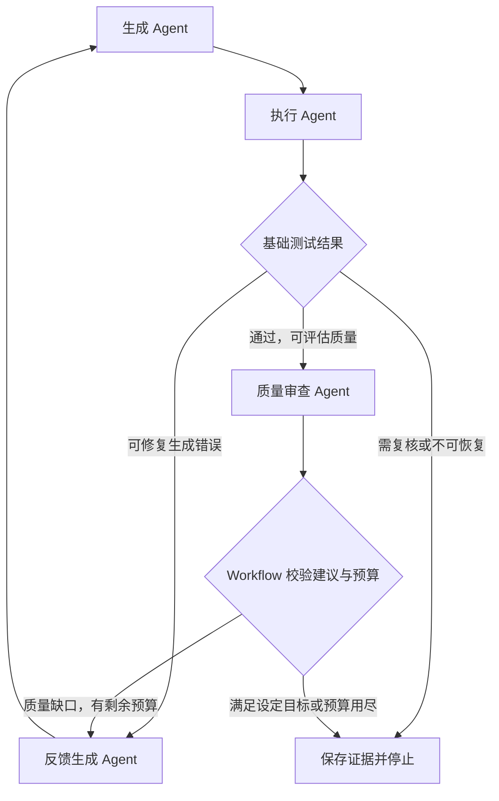

# 测试 Workflow 升级路线图

> 基于 2026-10-13 的实现评估：核心课程 MVP 已完成，当前全量回归 711 项通过。本文列出建议扩展，均为待开发内容，不代表现有能力。工时是结合当前代码的工程估计，包含适配与必要验证，不包含大规模真实模型实验费用。

## 1. 推荐的升级目标

将当前“生成测试、执行并达到覆盖率”的流程，升级为“生成、执行、审查测试有效性，并依据质量证据改进”的三 Agent 工作流。

优先考虑三件事：

1. 让测试质量有可观察的证据，而不只看覆盖率。
2. 让第三个 Agent 有独立判断和反馈，真正影响流程。
3. 用对照实验说明新增能力有没有收益，以及付出的时间和模型调用成本。

保持既有两个 Agent、状态保护和回归作为基线。新功能使用显式配置启用，基线仍可独立运行，以便演示和比较。

## 2. 可扩展方向与投入

| 方向 | 预计额外工时 | 主要收益 | 优先级 |
|---|---:|---|---|
| 源码必填、规格选填 | 4–7h | 使用门槛降低，落实此前讨论的输入方式 | 高，若这是期望的产品入口 |
| 第三个测试质量审查 Agent | 8–14h | Agent 协作更完整，质量建议参与路由 | 高 |
| 有限变异测试与缺口反馈 | 10–16h | 检验测试能否发现人为引入的小缺陷 | 高 |
| 小型对照实验与指标报告 | 5–8h | 为质量提升提供实证，而不是只展示架构 | 高，完成相关扩展后进行 |
| 固定流程图、消息时间线、历史列表 | 4–8h | 更容易理解和演示协作过程 | 中高 |
| 声明式路由与通用节点调度 | 8–14h | 支持新增业务节点和修改流程 | 中高，部分工作可与审查 Agent 接入合并 |
| 人工复核后继续运行 | 6–12h | 让 needs_review 成为可处理的工作环节 | 中 |
| Hypothesis 属性测试 | 8–14h | 搜索更多输入并输出简化后的反例 | 中 |
| 中断识别、重试、断点恢复 | 10–16h | 已保存任务可以受控恢复 | 中 |
| 多文件 Python 小项目 | 16–28h | 输入更接近实际项目 | 后续，改动面较大 |

工时不能直接全部相加：审查 Agent 与路由扩展存在重叠，实验与 UI 也可能共享数据契约。选定组合后应重新拆任务并保留约 20% 的集成缓冲。

## 3. 源码必填、规格选填

### 应实现的行为

- 提供规格：沿用 specification 模式，检验明确预期。
- 不提供规格：使用 characterization 模式，生成记录现有行为的回归测试，报告明确写出断言来自实现假设。
- 对缺少独立预期依据的行为，不自动宣称业务正确或已确认源码缺陷。

### 实施任务

- [ ] 将 CLI/Web 规格改为可选，区分未提供、空文本和文件读取失败。
- [ ] 在 create_run 中选择并保存 oracle_mode；不要让模式只存在于页面。
- [ ] 修改两个适配器的非空规格门禁，使其按模式校验输入。
- [ ] 复用 AgentDev 已有 CHARACTERIZATION 契约与 Prompt；确保后续轮次不改变模式。
- [ ] 调整缺陷归因、报告与完成条件的解释，避免将实现假设当独立需求。
- [ ] 验证无规格首轮与反馈、带规格缺陷复核，以及状态读取兼容性。

若想使用 docstring 作为需求依据，应单独设计其来源和可信程度，不要在现有 characterization 模式中混入未登记的规范性断言。

**演示案例：**同一源码无规格时生成现有行为测试；提供与实现不同的明确规格后，输出保留失败断言的复核结论。

## 4. 新增 TestQualityReviewAgent

### 推荐职责

审查 Agent 接收规格/断言来源、测试计划、候选代码、实测结果、覆盖缺口和可选变异结果，识别：

- 已执行但断言过弱的场景。
- 缺少明确边界输入的分支。
- 规格条目与测试之间的遗漏。
- 重复测试和与目标行为关系不大的断言。
- 存活变异体所暴露的测试缺口。

输出结构化 QualityAssessment：问题、来源证据、涉及函数/测试/规格条目、建议补充场景和动作。主观置信度可以记录，但不能代替证据。

### 推荐流程

### 配套开发

- [ ] 建立单独的 QualityAssessment，不把审查意见伪装成 pytest 执行结果。
- [ ] 增加 review_feedback 消息，包含来源候选、证据和目标生成轮次。
- [ ] 扩展当前固定两节点的调度，让审查发生在最终业务结论提交之前。
- [ ] 允许生成 Agent 消费授权的审查反馈，保留既有执行反馈校验。
- [ ] 把覆盖达标但存在测试质量缺口作为明确状态或质量标签，避免改写旧状态含义。
- [ ] 采用统一候选预算及独立审查请求预算，不能让执行和审查各自无限重试。
- [ ] 保护历史已通过测试；质量改进只能增加有效场景，不能弱化既有断言。
- [ ] 用合法建议、无证据建议、错误候选引用和预算耗尽验证路由。

审查 Agent 可调用模型，但模型没有发现问题并不能证明测试充分。Workflow 应验证建议类型、证据归属和允许的动作，疑似业务缺陷仍由既有保守策略处理。

**演示案例：**首轮测试已达到覆盖率目标，审查指出一个有实测依据的质量缺口，生成 Agent 补充测试，最终报告展示新增场景及效果。

## 5. 有限变异测试——最推荐的质量增强

### 为什么值得做

将被测源码中的一个小操作改错，再运行原测试。例如将 `x >= 100` 改为 `x > 100`：如果测试仍全部通过，就说明当前测试没有识别这一行为变化。通过的基线测试在变异后失败，称为检出或杀死该变异体。

覆盖率记录哪些代码或分支被执行；变异测试补充“测试是否会对特定错误产生反应”的证据。它同样不能证明业务完全正确。相关定义和工具行为可参考 [mutmut 官方文档](https://mutmut.readthedocs.io/en/latest/)。

### 适合本项目的第一版

- 先支持比较运算符替换、部分算术运算符替换、受限常量扰动。
- 每次只修改一个 AST 节点，保留位置、原表达式和新表达式。
- 每个候选最多评估 10–20 个变异体，并配置单体超时与总预算。
- 只在基线测试通过时执行变异评估；原测试已失败时标记未评估，不能得到有效分数。
- 每个变异体在独立副本中执行，不修改原始源码、当前候选或已登记摘要文件。

当前开发环境是 Windows。mutmut 官方要求 fork 支持，Windows 使用它需要 WSL。因此可选择先实现适配现有单文件范围的有限 AST 变异器，或先验证 WSL 执行路线，再决定是否引入完整工具。不要把环境迁移当成零成本步骤。

### 实施任务

- [ ] 为变异副本建立单独工作区，避免触发既有源码完整性门禁。
- [ ] 保存变异位置、操作类型、源码哈希和基线候选标识。
- [ ] 为每个变异体实际执行测试，保存检出、存活、超时、无效和未评估状态。
- [ ] 记录每个变异体的测试进程次数；与正式候选 pytest 次数分开统计。
- [ ] 报告主要比例采用 `killed / (killed + survived)`，同时展示超时、无效、未评估和疑似等价情况；不能全部算成检出。
- [ ] 不自动声称所有存活变异体都是真实缺陷；部分变化可能语义等价，需要标注或复核。
- [ ] 将存活变异体交给质量审查 Agent，结合规格提出补充输入和有效断言。
- [ ] 第二轮沿用同一组变异体或报告评估集合差异，保证前后指标可比较。

**演示案例：**第一轮测试达到 100% 覆盖，但漏掉恰好等于门槛的输入；边界运算符变异存活；第二轮新增门槛测试后检出该变异。该反馈循环可以由受控候选先稳定复现，再进行真实模型验收。

## 6. 对照实验与质量报告

采用相同案例比较：

1. 当前双 Agent 基线。
2. 加入质量审查 Agent。
3. 加入质量审查与变异反馈。

- [ ] 准备 6–10 个满足当前输入边界的案例，包含正确实现、明确边界缺陷和多函数协作。
- [ ] 明确已知缺陷与期望结果，固定模型、其余配置和案例输入。
- [ ] 记录完成率、可评估缺陷检出、错误归因、行/分支覆盖、变异结果、轮次、耗时、请求数和用量。
- [ ] 在固定任务预算下比较效果，同时单独报告审查增加的模型费用与测试开销。
- [ ] 条件允许时重复运行，保留失败与人工复核案例，不只展示成功案例。
- [ ] 区分离线机制验证、真实模型效果和客户端格式修复。
- [ ] 新模式未提高某些指标时如实记录，避免用不同分母比较缺陷检出率。

已有 66 项 checkout 手工参考测试可作为输入规格与预期的资产，但不能替代真实生成流程的端到端实验。

## 7. 可视化、历史任务与人工复核

### 界面增强

- [ ] 增加固定 Workflow 图，依据事件高亮当前节点与反馈边。
- [ ] 点击节点显示该次 Context、Result、执行证据与耗时。
- [ ] 点击消息显示来源轮次、候选、反馈依据与消费位置。
- [ ] 从磁盘扫描历史状态并重建列表，重启服务后仍能查看已结束任务。
- [ ] 增加两轮测试和指标差异展示，帮助解释改进原因。

保持图结构固定也能有效演示；拖拽编辑器应排在明确路由契约之后。

### 人工复核闭环

让用户对 needs_review 添加规格澄清或确认误判，然后创建关联的继续任务。

- [ ] 保存人工输入、操作者决定、旧任务标识及来源证据。
- [ ] 将追加规格作为新版输入，明确记录规格版本，不覆盖旧运行事实。
- [ ] 根据决定补充测试或重跑；不要将“用户点击确认”直接写成测试通过。
- [ ] 首版采用关联新任务，后续再考虑在同一任务内安全恢复。

关联新任务通常比直接修改已结束状态更容易保持可追溯性。

## 8. 声明式路由与恢复

### 路由扩展

当前 Workflow 固定要求前两个节点是生成与执行，后续节点主要读取已确定结论。建议先把这些固定语义提取为正式的测试流程策略，再扩展节点与允许的状态转换。

- [ ] 定义节点的输入、输出能力，以及可消费的消息类型。
- [ ] 定义带条件的路由，条件由宿主规则计算，模型只返回受限建议。
- [ ] 启动前校验未知节点、缺失依赖、非法循环和预算。
- [ ] 保留单进程顺序执行，先支持三 Agent 路由，不同时引入任意 DAG 和并行。
- [ ] 能通过替换流程定义启用双 Agent 基线或三 Agent 质量流程。

### 恢复扩展

- [ ] 持久化节点尝试标识，区分开始、输出已保存、结果已提交。
- [ ] 服务重启时把未结束任务识别为 interrupted，不能继续显示 running。
- [ ] 已提交生成候选与已完成执行可校验后复用。
- [ ] 对请求已发出但结果未知的模型调用，明确标注，不盲目宣称未执行或自动重复调用。
- [ ] 重试使用新的 attempt 产物路径，保持旧证据。
- [ ] 验证中断发生在生成前后、执行前后和导出阶段的行为。

恢复涉及消息、事件、状态和外部副作用的一致性，实际投入通常高于增加一个 resume 命令。第一版可先完成中断识别和关联新任务重试。

## 9. 属性测试与多文件支持

### 属性测试

Hypothesis 可按输入策略生成大量样例，并在发现失败后尝试简化反例，见 [官方介绍](https://hypothesis.works/)。第一版建议从单函数属性开始；多操作序列可后续参考 [状态测试文档](https://hypothesis.readthedocs.io/en/latest/stateful.html)。

- [ ] 从明确规格提取属性，如排序后单调、编码解码往返、明确约束下的总价非负。
- [ ] 给属性记录适用输入范围和依据，不能把看起来合理的规则直接当真。
- [ ] 为生成测试显式允许 Hypothesis 导入与特定装饰器；现有校验只允许 pytest/标准库和受限 pytest 装饰器。
- [ ] 调整场景映射、参数化函数与历史保护校验，仍禁止弱化已有预期。
- [ ] 记录运行配置、反例和复现方式，保证后续能重放失败。

不要只安装依赖后开放所有第三方导入和装饰器。

### 多文件小项目

建议先限定到 2–5 个纯 Python 模块、无第三方依赖的静态调用项目。

- [ ] 从目录读取项目，确定入口与目标文件列表。
- [ ] 将单个 SourceInfo 扩展为带模块标识的源码事实集合。
- [ ] 处理跨文件符号与直接调用、测试导入和项目副本工作区。
- [ ] 为每个目标文件采集覆盖，避免只统计 subject.py。
- [ ] 修改 Prompt、场景映射、路径校验、报告和候选保存契约。
- [ ] 明确动态导入或无法解析调用的边界，并准备跨模块协作样例。

这是输入模型和执行模型的扩展，不能仅放宽上传数量。

## 10. 推荐实施组合

### 约 40 小时额外开发：优先提升测试质量

| 顺序 | 内容 | 目标预算 |
|---|---|---:|
| 1 | 源码可独立输入，并保持规格模式兼容 | 5h |
| 2 | 审查 Agent + 必需的三节点契约与路由 | 11h |
| 3 | 有限变异器、实测证据与质量反馈 | 12h |
| 4 | 小型真实对照实验与报告 | 6h |
| 5 | 流程图与质量指标展示 | 6h |
| 合计 | 功能与验证 | 40h |

另留约 8h 集成缓冲。实际模型费用和是否联网运行实验，需要在执行时按选定案例与预算处理；本文不发起调用。

最有辨识度的最终展示：**首轮覆盖已达标，但边界变异存活 → 审查 Agent 给出有证据的补充建议 → 生成 Agent 新增用例 → 执行通过且检出变异 → 报告展示改善与成本。**

### 如果更重视 Workflow 引擎

可将上述变异测试与实验部分替换为声明式路由、中断识别、关联任务恢复和历史可视化。最终证明新增节点、改变流程和处理失败的能力；测试质量提升不作为主要承诺。

### 更长的后续开发

基础质量流程稳定后，再选择属性测试或多文件支持。优先只选一项；多语言、任意仓库、拖拽编辑器和分布式调度会显著扩大范围，适合作为独立后续版本。

## 11. 每项扩展的完成判据

- 新能力在 CLI 与 Web 的适用范围明确，入口、状态与报告一致。
- 旧双 Agent 基线可以继续运行并通过相关回归。
- 新增 Agent 的输入、判断、输出和反馈消费有独立证据。
- 质量指标来自真实工具运行，模型意见与实测结论分别记录。
- 默认参数、候选轮次、额外请求和额外测试进程均受预算控制。
- 新增依赖、vendor 修改与来源清单有记录。
- 真实实验和离线演示明确区分，效果结论与数据一致。
- 文档、清单和演示同步到最终实现。
